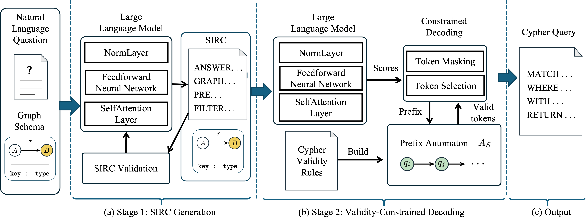

# SAVCypher
A PyTorch Implementation of VLDB submission "Text-to-Cypher Generation via Semantic Intermediate Representation and Validity-Constrained Decoding". 

## Introduction

Graph databases have become the key infrastructure for storing graph data, and Cypher is the most widely adopted language for querying them. Text-to-Cypher aims to automatically translate natural language (NL) questions into Cypher queries, acting as a key technique to empower intelligent graph database interaction. While large language models (LLMs) have been employed for the Text-to-Cypher task, generating accurate queries remains challenging due to semantic and validity errors. To address these issues, this paper proposes SAVCypher, a two-stage Text-to-Cypher framework that combines a semantic intermediate representation and validity-constrained decoding. For semantic interpretation, SAVCypher introduces SIRC, a Semantic Intermediate Representation for Cypher, which makes the graph semantics of NL questions explicit while abstracting away Cypher execution details. Based on SIRC, SAVCypher generates the final Cypher query through validity-constrained decoding, using a prefix automaton to check candidate tokens against Cypher grammar, scope, schema, and expression constraints. <div align=center></div>

## Folder Structure
Here we list the descriptions of the folders:
```
├── convert: loads gold Cypher queries and saves their SIRC representations in JSONL format
    ├── convert/sirc: the code of converting gold Cypher queries into SIRC
├── prepare: the code of preparing paired MTL training data from SIRC JSONL
├── train: the code of jointly training Question→SIRC and SIRC→Cypher with MTL-LoRA
    ├── train/mtl_lora: the code of the MTL-LoRA adapter layers
├── infer: the code of two-stage inference (Question→SIRC→Cypher)
├── ablation_study: the code of ablation study
```

## Requirements
* Conda
  * install conda: Please refer to the [conda official website](https://conda.io/projects/conda/en/latest/user-guide/install/index.html)
  * Create a new conda environment:
      * if you are running with GPU:
        ```
        conda env create -f environment-gpu.yml
        conda activate SAVCypher
        ```
        Dependencies include support for CUDA_11.4. If you are using a different CUDA version, update the dependencies accordingly.
      * if you are running with CPU:   
        ```
        conda env create -f environment-cpu.yml
        conda activate SAVCypher
* Dependency

All dependencies and their versions for SAVCypher are listed in requirement.txt. After activating the SAVCypher environment, install them using the following command:
```
pip install -r requirement.txt
```

## Dataset
We conducted experiments using four widely used datasets in the Text-to-Cypher field, including Text2Cypher, CypherBench, Mind-the-Query, and SynthCypher.

* Text2Cypher. Text2Cypher, released by Neo4j, unifies several public sources into a common format and covers a broad range of question styles, with 39,554 training and 4,833 test instances. Text2Cypher data is obtained from https://github.com/neo4j-labs/text2cypher.

* CypherBench.CypherBench contains template-based questions over 11 large property graphs derived from Wikidata. The dataset is split by domain, with 8,817 training instances over four graphs and 2,488 test instances over the remaining seven graphs. CypherBench data is obtained from https://huggingface.co/datasets/megagonlabs/cypherbench.

* Mind-the-Query. Mind-the-Query contains pairs of NL questions and Cypher queries over 11 real-world graph databases. The dataset includes 18,470 training instances, and 7,059 test instances. Mind-the-Query data is obtained from https://github.com/endeavorXx/Mind-the-Query.

* SynthCypher. SynthCypher is constructed using LLMs to generate database schemas, NL questions, and associated Cypher queries. The dataset has 25,800 training and 4,000 test instances. SynthCypher data is obtained from https://huggingface.co/datasets/ServiceNow-AI/SynthCypher.

## A Guide to Replication
Our evaluation is performed on an Ubuntu 22.04.5 server equipped with two RTX A6000 GPUs.

### Data Preprocessing

Before running the experiments, we preprocess the data to prepare training datasets for the models. This involves two steps: (1) converting gold Cypher queries into SIRC representations, and (2) combining these representations with the original data to construct the training datasets.

(1) Converting gold cypher queries to SIRC

To obtain the SIRC representations, we use a set of conversion rules to transform each gold Cypher query into its corresponding SIRC representation. We use the following command to convert gold Cypher queries into SIRC representations.

```
python -m convert --dataset dataset_name --output-dir ./sirc_data/dataset_name --data-root ./dataset_name
```
(2) Constructing training datasets

After obtaining the SIRC representations, we need to construct separate training datasets for the two-stage models from the original Text-to-
Cypher dataset. Each original example contains an NL question 𝑥, a graph schema 𝑆, and a gold Cypher query 𝑦. We add the corresponding SIRC representation 𝑧 and construct training data for both stages: ((𝑥, 𝑆), 𝑧) trains the first-stage model to generate SIRC, and ((𝑧, 𝑆), 𝑦) trains the second-stage model to generate Cypher queries. 
```
python -m prepare --input ./sirc_data/dataset_name.jsonl --output-dir ./sirc_data/mtl/dataset_name --seed 42   --schema-token-budget 1024 --tokenizer ./LLM_dir
```
### RQ1 Effectiveness

To evaluate SAVCypher, we conduct experiments on four Text-to-Cypher datasets.  Our RQ1 experiments consist of two steps: model training and model testing.

(1) SAVCypher training

Since the models in both stages need to understand graph schemas and Cypher query semantics, we adopt MTL-LoRA to train them jointly. We use the following command to train SAVCypher.
```
deepspeed --include=localhost:0,1 --master_port=25000 train/train.py --base-model LLM_dir --train-file ./sirc_data/mtl/dataset_name/train.jsonl --dev-file ./sirc_data/mtl/dataset_name/dev.jsonl --output-dir ./outputs_dir --deepspeed train/config/ds3.json --max-length 1024 --epochs 10 --learning-rate 5e-4   --logging-steps 10 --eval-strategy epoch --adapter-save-steps 50 --rank 8   --dropout 0.05
```

(2) SAVCypher testing

After training SAVCypher, we evaluate its performance on the test set using the following command.
```
CUDA_VISIBLE_DEVICES=0,1 python -m infer --checkpoint ./outputs_dir/adapter-checkpoints/checkpoint --base-model /LLM_dir --input-file ./sirc_data/mtl/dataset_name/test.jsonl --output-file ./outputs/dataset_name/test_predictions.jsonl --max-ir-tokens 1024 --max-sirc-attempts 3 --sirc-retry-temperature 0.8
```
### RQ2 Impact Analysis
To show the contribution of each component, we conduct ablation experiments and remove specific components separately. 
* First, to see whether the automaton helps reduce validity errors, we replace SAVCypher with w/o Automaton, which retains the two stages but generates query without decoding constraints. 
* Next, to see whether SIRC helps capture query semantics, we replace SAVCypher with w/o SIRC, which generates query directly from the question and schema while retaining the automaton. 
* Finally, we replace SAVCypher with w/o Both, which removes both components and uses a single-stage model fine-tuned on the same training data for unconstrained decoding. 

(1) w/o Automaton. The code for w/o Automaton is available in ablation_study/wo_automaton . We use the following commands to train and test the model.

Model training.
```
bash ablation_study/wo_automaton/train.sh CUDA_VISIBLE_DEVICES=0,1 PYTHONPATH=MTL-LoRA:. python ablation_study/wo_automaton/eval.py --stage1-checkpoint outputs/ablation/wo_automaton/stage1 --stage2-checkpoint outputs/ablation/wo_automaton/stage2  --base-model LLM_dir --input-file ./sirc_data/mtl/dataset_name/train.jsonl --output-dir outputs/ablation/wo_automaton/
```
Model testing.
```
CUDA_VISIBLE_DEVICES=0,1 PYTHONPATH=MTL-LoRA:. python ablation_study/wo_automaton/infer.py --stage1-checkpoint outputs/ablation/wo_automaton/stage1 --stage2-checkpoint outputs/ablation/wo_automaton/stage2 --base-model LLM_dir --input-file ./sirc_data/mtl/dataset_name/test.jsonl --output-file outputs/ablation/wo_automaton/predictions.jsonl --max-input-tokens 1024 
```

(2) w/o SIRC. The code for w/o SIRC is available in ablation_study/wo_sirc. We use the following commands to train and test the model.

Model training.
```
bash ablation_study/wo_sirc/train.sh CUDA_VISIBLE_DEVICES=0,1 PYTHONPATH=MTL-LoRA:. python ablation_study/wo_sirc/eval.py --checkpoint outputs/ablation/wo_sirc --base-model LLM_dir --input-file ./sirc_data/mtl/dataset_name/train.jsonl  --output-dir outputs/ablation/wo_sirc/
```
Model testing.
```
CUDA_VISIBLE_DEVICES=0,1 PYTHONPATH=MTL-LoRA:. python ablation_study/wo_sirc/infer.py --checkpoint outputs/ablation/wo_sirc --base-model LLM_dir --input-file ./sirc_data/mtl/dataset_name/test.jsonl --output-file outputs/ablation/wo_sirc/predictions.jsonl --max-input-tokens 1024 
```

(3) w/o Both. The code for w/o Both is available in ablation_study/wo_both. We use the following commands to train and test the model.

Model training.
```
bash ablation_study/wo_both/train.sh CUDA_VISIBLE_DEVICES=0,1 PYTHONPATH=MTL-LoRA:. python ablation_study/wo_both/eval.py --checkpoint outputs/ablation/wo_both --input-file ./sirc_data/mtl/dataset_name/train.jsonl --output-dir outputs/ablation/wo_both/
```
Model testing.
```
CUDA_VISIBLE_DEVICES=0,1 PYTHONPATH=MTL-LoRA:. python ablation_study/wo_both/infer.py --checkpoint outputs/wo_both/checkpoint --base-model LLM_dir --input-file ./sirc_data/mtl/dataset_name/test.jsonl --output-file outputs/ablation/wo_both --max-input-tokens 1024
```

### RQ3 Query Complexity

To more thoroughly evaluate SAVCypher, we study its performance across different levels of query complexity. Generating more complex queries can increase the risk of semantic and validity errors. We use the complexity labels available in Text2Cypher and Mind-the-Query to categorize the test queries along two dimensions: whether they involve aggregation and whether their structure is simple. This yields four categories: simple retrieval (SR), complex retrieval (CR), simple aggregation (SA), and complex aggregation (CA).

(1) We first extract the examples corresponding to the four complexity labels from the test set.
```
python3 rq3_group_complexity.py --text2cypher-test ./sirc_data/mtl/text2cypher/test.jsonl --mind-test ./sirc_data/mtl/mind_the_query/test.jsonl --text2cypher-sr outputs/rq3_complexity/text2cypher/SR.jsonl --text2cypher-cr outputs/rq3_complexity/text2cypher/CR.jsonl --text2cypher-sa outputs/rq3_complexity/text2cypher/SA.jsonl --text2cypher-ca outputs/rq3_complexity/text2cypher/CA.jsonl --mind-sr outputs/rq3_complexity/mind_the_query/SR.jsonl --mind-cr outputs/rq3_complexity/mind_the_query/CR.jsonl --mind-sa outputs/rq3_complexity/mind_the_query/SA.jsonl --mind-ca outputs/rq3_complexity/mind_the_query/CA.jsonl
```

(2) We then use the same testing command as in RQ1 to evaluate model performance across different query complexity.
```
CUDA_VISIBLE_DEVICES=0,1 python -m infer --checkpoint ./outputs_dir/adapter-checkpoints/checkpoint --base-model /LLM_dir --input-file ./sirc_data/mtl/dataset_name/test.jsonl --output-file ./outputs/dataset_name/test_predictions.jsonl --max-ir-tokens 1024 --max-sirc-attempts 3 --sirc-retry-temperature 0.8
```

### RQ4 Cross-Dataset Prediction

To further examine the generalization of SAVCypher, we conduct a cross-dataset evaluation using the four datasets. We pair the training split of
each dataset with the test splits of the other three datasets, forming 12 evaluation pairs. 
We evaluate the models trained in RQ1 on the test sets of other datasets using the same testing commands as in RQ1.
```
CUDA_VISIBLE_DEVICES=0,1 python -m infer --checkpoint ./outputs_dir/adapter-checkpoints/checkpoint --base-model /LLM_dir --input-file ./sirc_data/mtl/dataset_name/test.jsonl --output-file ./outputs/dataset_name/test_predictions.jsonl --max-ir-tokens 1024 --max-sirc-attempts 3 --sirc-retry-temperature 0.8
```

